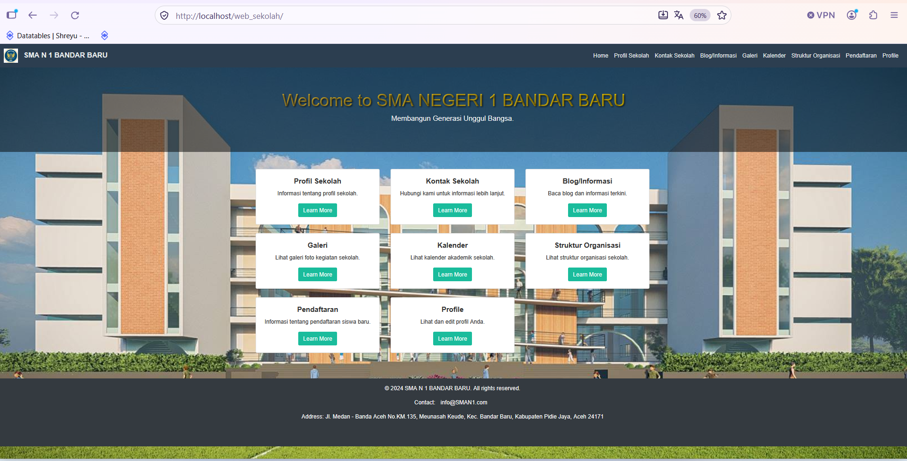
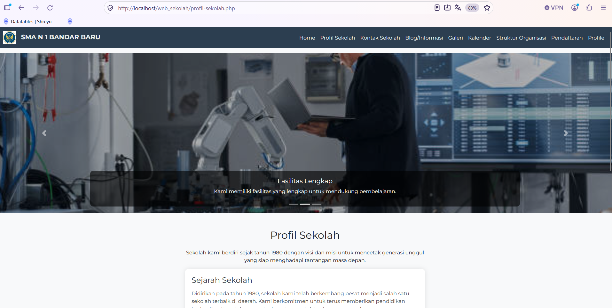
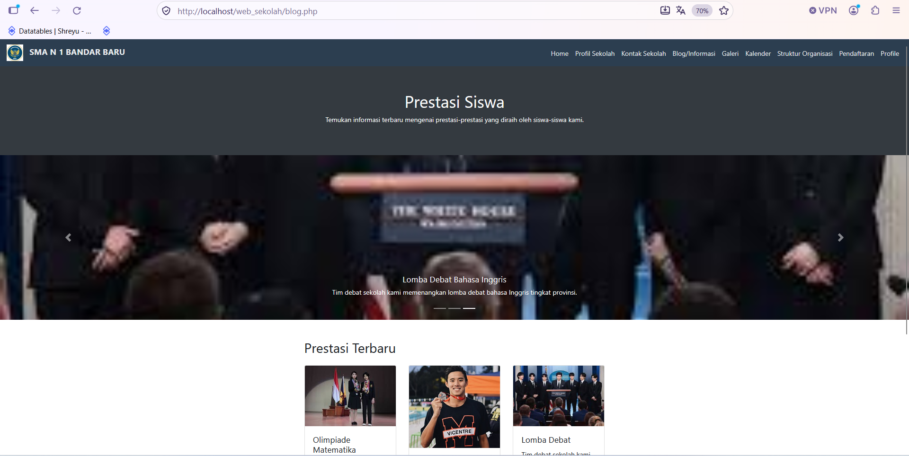
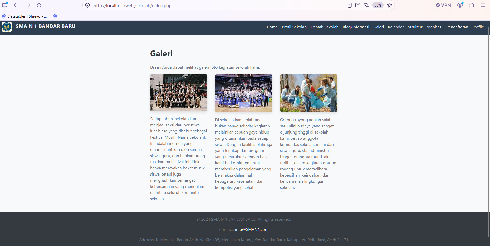

# 🏫 Sistem Informasi Sekolah SMA N 1 Bandar Baru

## 📌 Deskripsi Proyek
Sistem informasi berbasis web yang dirancang sebagai 
media publikasi digital sekolah. Proyek ini dikembangkan 
pada Semester 3 sebagai implementasi mata kuliah 
Pemrograman Framework, dengan fokus pada pengembangan 
tampilan antarmuka (front-end).

> ⚠️ **DISCLAIMER:**
> Nama sekolah "SMA N 1 Bandar Baru" digunakan murni 
> sebagai contoh/simulasi akademis untuk keperluan 
> pembelajaran pengembangan web. Proyek ini tidak 
> diterapkan secara nyata dan tidak berafiliasi resmi 
> dengan institusi tersebut. Tidak ada data asli 
> sekolah yang digunakan.

## 🎯 Fitur Utama
- Halaman Profil Sekolah
- Kontak Sekolah
- Blog & Informasi Terkini
- Galeri Foto Kegiatan
- Kalender Akademik
- Struktur Organisasi
- Halaman Pendaftaran

## 🛠️ Tech Stack
- **Backend**: PHP (Framework)
- **Frontend**: HTML, CSS, JavaScript

## 📸 Screenshot Sistem

### Halaman Utama

### Blog & Informasi

### Profil Sekolah

### Galeri

## 📂 Source Code
Source code tersedia atas permintaan. Silakan hubungi sriramadani596@gmail.com.

## 👤 Developer
**Sri Ramadhani**
S1 Informatika — Universitas Almuslim (2026)
IPK: 3,90 | Cumlaude | Wisudawan Terbaik 2026
📧 sriramadani596@gmail.com
